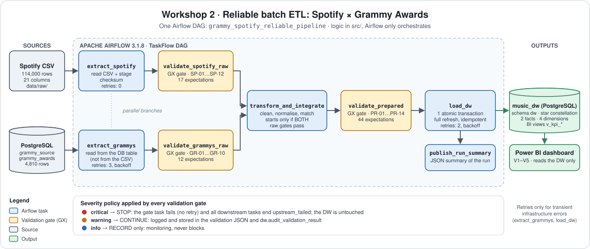
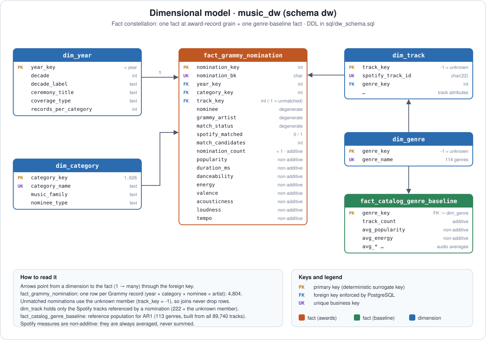

<div align="center">

# 🎵 Workshop 2 · Reliable Batch Data Pipeline
### Spotify × Grammy Awards

**ETL** · Data Engineering and Artificial Intelligence · Universidad Autónoma de Occidente

</div>

A batch ETL pipeline orchestrated with **Apache Airflow 3.1.8** that extracts Spotify data from a CSV and Grammy data from a **PostgreSQL** source, validates both with **Great Expectations 1.23.1**, transforms and integrates them, validates the result again and loads a **star-schema data warehouse** in PostgreSQL that feeds a **Power BI** dashboard. Every claim below links to evidence in [`docs/evidence/`](docs/evidence/).

> Spanish step-by-step guide for running it on your computer: **[GUIA_PASO_A_PASO.md](GUIA_PASO_A_PASO.md)**.

---

<a id="s1"></a>

## 🎯 1. Problem and analytical objective

A music-industry analyst wants to know whether winning or being nominated for a **Grammy** is reflected in how a track is consumed on **Spotify**, and whether the "Grammy sound" has changed over time. Neither source answers this alone: Spotify has no award information, and the Grammy table has no popularity, audio features or genre. They share no identifier, so the pipeline integrates them by title and artist name. The match rate is therefore treated as a quality metric and a KPI, not a footnote.

**Scope.** In scope: track-level integration of both sources, three validation gates, a star-schema DW, KPIs read from the DW. Out of scope: causal claims, any use of the Grammy `winner` flag (unreliable, see Sec. 5), live Spotify API enrichment.

---

<a id="s2"></a>

## 📋 2. Analytical requirements

| ID | Question | Why both sources | KPI / metric | Level of detail |
|---|---|---|---|---|
| **AR1** | Do Grammy-recognised tracks have higher Spotify popularity than the typical track of their genre, and how does that vary by decade of recognition? | Recognition (Grammy) × popularity and genre baseline (Spotify) | average popularity; **popularity lift** = popularity − genre baseline | decade, genre |
| **AR2** | How has the audio profile (danceability, energy, valence, acousticness, loudness) of Grammy-recognised tracks changed across decades? | Decade (Grammy) × audio features (Spotify) | average of each feature | decade |
| **AR3** | Which Spotify genres and Grammy music families concentrate recognised tracks, and how well can the sources be integrated? | Category / family (Grammy) × genre (Spotify) | matched nominations; **match rate**; average popularity | genre, music family |

**Required attributes.**

| Requirement | Grammy attributes | Spotify attributes |
|---|---|---|
| AR1 | `year`, `category`, `nominee`, `artist` | `track_id`, `track_name`, `artists`, `popularity`, `track_genre` |
| AR2 | `year`, `nominee`, `artist` | `danceability`, `energy`, `valence`, `acousticness`, `loudness`, `tempo` |
| AR3 | `category`, `nominee`, `artist` | `track_genre`, `track_name`, `artists` |

Not carried to the DW because no requirement needs them: Grammy `winner`, `workers`, `img`, `published_at`, `updated_at`; Spotify `key`, `mode`, `speechiness`, `liveness`, `instrumentalness`, `time_signature`, `Unnamed: 0`.

**Traceability IDs** used across code, tests and evidence: `AR` requirement · `SP-` / `GR-` raw quality rule · `PR-` prepared quality rule · `T` transformation decision · `V` dashboard visual.

Full detail: [`docs/requirements_traceability.md`](docs/requirements_traceability.md).

---

<a id="s3"></a>

## 🗂️ 3. Data sources

| Source | Provided as | Pipeline extracts from | Size |
|---|---|---|---|
| Spotify tracks | `data/raw/spotify_dataset.csv` | the CSV file | 114,000 rows (89,741 distinct `track_id`) |
| Grammy awards | `data/raw/the_grammy_awards.csv` | PostgreSQL table `grammy_source.public.grammy_awards` | 4,810 rows |

**Source preparation.** `scripts/load_grammy_source.py` loads the Grammy CSV into PostgreSQL ([`sql/source_setup.sql`](sql/source_setup.sql)) and reconciles CSV against table (it must print `RECONCILED: True`). This is **not** the ETL load: it only creates the operational relational source the pipeline extracts from. `sql/00_create_databases.sh` creates the `grammy_source` and `music_dw` databases.

**Evidence that the pipeline reads Grammy from the database and not from the CSV:** the `extract_grammys` task reads the table `grammy_source.public.grammy_awards`, and a missing table raises a contract error instead of falling back to a file.

---

<a id="s4"></a>

## 🏗️ 4. Pipeline architecture

<div align="center">

</div>

The pipeline is a **batch ETL** (transform before load) orchestrated by a single Airflow DAG, [`dags/`](dags/) → `grammy_spotify_reliable_pipeline`, written with the TaskFlow API. The two sources are extracted and validated **independently and in parallel**, converge in one transformation step, pass a second validation gate, and only then are loaded into the star schema. The logic of each task lives in `src/` (`extract.py`, `validation.py`, `quality_rules.py`, `transform.py`, `load.py`); the DAG only describes the workflow.

| # | Task | What it does | Failure policy |
|---|---|---|---|
| 1 | `extract_spotify` | Reads the Spotify CSV and stages it with a checksum | No retry (a missing file is deterministic) |
| 2 | `extract_grammys` | Reads Grammy data from the PostgreSQL source table, **not** from the CSV | Retries: 3, exponential back-off with jitter (base 20 s, max 2 min) |
| 3 | `validate_spotify_raw` | Raw gate, rules SP-01 to SP-12 | No retry; a Critical failure stops downstream |
| 4 | `validate_grammys_raw` | Raw gate, rules GR-01 to GR-10 | No retry; a Critical failure stops downstream |
| 5 | `transform_and_integrate` | Cleans, standardises and integrates both sources (T1–T12). Starts only when **both** raw gates pass | No retry |
| 6 | `validate_prepared` | Prepared gate, rules PR-01 to PR-14 | No retry; a Critical failure blocks the load |
| 7 | `load_dw` | Writes the star schema in one atomic, idempotent transaction | Retries: 2, exponential back-off with jitter (base 30 s, max 3 min) |
| 8 | `publish_run_summary` | Read-only summary of the run | No retry |

**How to read it**

- **Validation gates.** Each gate runs Great Expectations and applies the severity policy: Critical stops the pipeline, Warning is recorded and the run continues, Informational is only recorded. When a gate fails, every downstream task ends as `upstream_failed`.
- **Selective retries.** Only tasks that touch a database can fail for transient reasons (`extract_grammys` and `load_dw`, which is one transaction and therefore safe to repeat). Every data-quality or contract error raises `AirflowFailException`, which Airflow never retries.
- **Light task interfaces.** Tasks exchange compact metadata (paths, counts, hashes), never data frames. Each run keeps its files in `data/work/<run_id>/`.
- **Source preparation is not the ETL load** (see Sec. 3).

---

<a id="s5"></a>

## 🔍 5. Data profiling findings and quality risks

Notebook: [`notebooks/data_profiling.ipynb`](notebooks/data_profiling.ipynb) (executed, outputs stored). It follows the three profiling types: **structural** (schema, types, row counts), **content** (nulls, ranges, distributions) and **relationship** (keys, duplicates, cross-source consistency). Profiling discovers; it does not clean and does not create rules automatically: each finding below is interpreted and linked to a rule or a transformation.

| Risk | Dataset / attribute | Evidence | Risk to the requirement | Dimension | AR | Rule | Decision |
|---|---|---|---|---|---|---|---|
| RISK-01 | Spotify `track_id` × `track_genre` | grain is track × genre; 24,259 repeated `track_id` | Counting rows as tracks double-counts songs | Uniqueness | AR1, AR3 | SP-04 (warning) | **T6:** one row per track; primary genre = highest-popularity copy |
| RISK-02 | Spotify `(track_id, track_genre)` | 450 exact duplicate pairs | Inflated genre baseline | Uniqueness | AR1, AR3 | SP-04 (warning, ≥ 99%) | **T4:** drop exact repeats, log the count |
| RISK-03 | Spotify `track_name`, `artists`, album | 1 row without any of them | Cannot be matched or labelled | Completeness | AR1, AR2, AR3 | SP-08 (warning) | **T3:** drop, log the count |
| RISK-04 | Spotify `tempo`, `danceability`, `valence` | 157 rows with tempo = danceability = speechiness = time_signature = 0 (audio analysis failed) | Impossible values bias the AR2 averages | Validity | AR2 | SP-10 (warning) | **T5:** → NULL (not imputed) |
| RISK-05 | Spotify `popularity`, audio features | inside their documented scales today | One out-of-scale value corrupts the KPIs | Validity | AR1, AR2 | SP-05, SP-06 (critical) | **Raw gate:** stop, never auto-correct |
| RISK-06 | Spotify `popularity` | 14% of tracks have `popularity = 0` | Looks suspicious but is a valid value | Accuracy (n/a) | AR1 | none | **Keep** the value |
| RISK-07 | Grammy `winner` | `True` in 100% of rows; 2019 lists all nominees | Winners cannot be distinguished; row grain differs by year | Consistency | AR1, AR2, AR3 | GR-08 (warning, expected to fail) | **Design:** never use `winner`; `dim_year.coverage_type` |
| RISK-08 | Grammy `artist` | 38% missing (songwriter / composer / technical categories) | Matching impossible for those rows | Completeness | AR1, AR2, AR3 | GR-06 (warning, ≥ 50%) | **T10:** recover from the same year + title, for matching only |
| RISK-09 | Grammy `nominee` | 6 missing (4 Remixer, 2 New Country & Western Artist) | Unidentifiable record | Completeness | AR1, AR2, AR3 | GR-05 (warning) | **T7:** drop, log the count |
| RISK-10 | Grammy `category` | 638 spellings vs 629 case-folded | Fragmented `dim_category` | Consistency | AR3 | PR-02 (critical) | **T8:** canonical spelling = most frequent |
| RISK-11 | Both: names | no shared key between the sources | Integration is approximate: misses and false matches | Consistency | AR1, AR2, AR3 | PR-05, PR-08, PR-09, PR-10 | **T11:** normalised title + artist; monitor coverage |
| RISK-12 | Both: coverage | only about 6% of Grammy records can be linked to a Spotify track | KPIs describe the matched subset only | Representativeness | AR1, AR2, AR3 | PR-10 (≥ 100 matches, critical) | Match rate shown as a KPI and in the dashboard |
| RISK-13 | Both: matches per decade | 5 matches in the 1950s, 20 in the 1960s | Averages of the oldest decades are unstable | Representativeness | AR1, AR2 | PR-10 | `n` shown next to every average |

The missing `artist` is **not random**: it concentrates in categories that honour songwriters, composers, producers or technical credits (*Song Of The Year* 70/70, *Opera Recording*, *Album Notes*, *Instrumental Composition*). It cannot be fixed without inventing data, so it is tolerated with a Warning threshold and recovered only for matching.

---

<a id="s6"></a>

## 📏 6. Quality rules

**36 rules**: 23 Critical, 12 Warning, 1 Informational. Each one protects a requirement and comes from profiling evidence, a source contract or a post-transformation invariant. The registry is `src/quality_rules.py`: the Great Expectations suites, [`docs/quality_rules.md`](docs/quality_rules.md) and [`docs/gx_expectation_mapping.csv`](docs/gx_expectation_mapping.csv) are all generated from it. Constraints the database already enforces (PK, FK, `UNIQUE`, `CHECK`) are checked again before loading by the prepared gate, so a violation is caught before it can break the load.

| Rule ID | Dataset / Layer | Attribute(s) | Quality Dimension | Quality Rule | Metric / Threshold | Severity | Requirements |
|---|---|---|---|---|---|---|---|
| SP-01 | Raw · spotify_raw | table schema | Validity (schema) | All attributes needed by AR1-AR3 must exist in the incoming file. | required columns present: all 14 required columns | Critical | AR1, AR2, AR3 |
| SP-02 | Raw · spotify_raw | table volume | Completeness (volume) | The batch must contain a plausible number of rows. | row count: 50,000 <= rows <= 500,000 | Critical | AR1, AR2, AR3 |
| SP-03 | Raw · spotify_raw | track_id | Completeness | track_id (business key) must never be missing. | % non-null track_id: 100% | Critical | AR1, AR2, AR3 |
| SP-04 | Raw · spotify_raw | track_id + track_genre | Uniqueness | The pair (track_id, track_genre) identifies one source row. | % rows in a unique pair: >= 99% | Warning | AR3 |
| SP-05 | Raw · spotify_raw | popularity | Validity | popularity must be an integer score between 0 and 100. | % values in [0, 100]: 100% | Critical | AR1 |
| SP-06 | Raw · spotify_raw | danceability, energy, valence | Validity | Audio features that are normalised scores must lie between 0 and 1. | % values in [0, 1]: 100% | Critical | AR2 |
| SP-07 | Raw · spotify_raw | loudness | Validity | loudness (dB) must be within the physically plausible range. | % values in [-60, 5]: >= 99.9% | Warning | AR2 |
| SP-08 | Raw · spotify_raw | track_name, artists | Completeness | Integration attributes (title and artists) should be present. | % non-null: >= 99.9% | Warning | AR1, AR2, AR3 |
| SP-09 | Raw · spotify_raw | track_genre | Completeness | Every track must carry a genre. | % non-null track_genre: 100% | Critical | AR1, AR3 |
| SP-10 | Raw · spotify_raw | tempo, duration_ms | Validity | Tempo and duration must be strictly positive. | % values > 0: tempo >= 99.5%; duration >= 99.9% | Warning | AR2 |
| SP-11 | Raw · spotify_raw | explicit | Validity | explicit must be a boolean flag. | % values in {True, False}: 100% | Warning | AR3 |
| SP-12 | Raw · spotify_raw | track_genre | Consistency (drift) | The number of distinct genres should stay close to the known catalogue (114). | distinct genres: 100 - 130 | Info | AR3 |
| GR-01 | Raw · grammys_raw | table schema | Validity (schema) | The Grammy source table must expose the attributes used by AR1-AR3. | required columns present: all 6 required columns | Critical | AR1, AR2, AR3 |
| GR-02 | Raw · grammys_raw | table volume | Completeness (volume) | The extracted table must contain a plausible number of rows. | row count: 1,000 <= rows <= 100,000 | Critical | AR1, AR2, AR3 |
| GR-03 | Raw · grammys_raw | year | Validity (temporal) | year must exist and be between the first Grammy edition (1958) and the current year. | % non-null and in range: 100% | Critical | AR1, AR2 |
| GR-04 | Raw · grammys_raw | category | Completeness | category must never be missing. | % non-null category: 100% | Critical | AR1, AR2, AR3 |
| GR-05 | Raw · grammys_raw | nominee | Completeness | nominee (work title) should be present. | % non-null nominee: >= 99% | Warning | AR1, AR2, AR3 |
| GR-06 | Raw · grammys_raw | artist | Completeness | artist must be present in enough rows to make title+artist matching meaningful. | % non-null artist: >= 50% | Warning | AR1, AR2, AR3 |
| GR-07 | Raw · grammys_raw | winner | Validity | winner must be a non-null boolean. | % values in {True, False}: 100% | Critical | AR1, AR2, AR3 |
| GR-08 | Raw · grammys_raw | winner | Consistency | The winner flag should discriminate winners from nominees (both values present). | distinct values contain {True, False}: both values | Warning | AR1, AR2, AR3 |
| GR-09 | Raw · grammys_raw | year + category + nominee + artist | Uniqueness | One source row per (year, category, nominee, artist). | % rows in a unique combination: 100% | Critical | AR1, AR2, AR3 |
| GR-10 | Raw · grammys_raw | year | Completeness (temporal coverage) | The batch must cover (almost) every Grammy edition. | distinct years: >= 60 | Warning | AR1, AR2 |
| PR-01 | Prepared · all prepared tables | table schema | Validity (schema) | Every prepared table must have exactly the columns of the dimensional model. | column set equals model: exact | Critical | AR1, AR2, AR3 |
| PR-02 | Prepared · dimensions | surrogate / business keys | Uniqueness | Dimension surrogate keys and business keys are non-null and unique. | % unique non-null keys: 100% | Critical | AR1, AR2, AR3 |
| PR-03 | Prepared · fact_grammy_nomination | nomination_bk, nomination_key | Uniqueness (grain) | One fact row per Grammy nomination record: business key and surrogate key are unique. | % unique keys: 100% | Critical | AR1, AR2, AR3 |
| PR-04 | Prepared · facts and dimensions | foreign keys | Consistency (referential integrity) | Every foreign key must exist in its dimension. | % FK values found in the dimension: 100% | Critical | AR1, AR2, AR3 |
| PR-05 | Prepared · fact_grammy_nomination | spotify_matched, track_key | Consistency (integration) | A nomination is flagged matched iff it points to a real dim_track member; unmatched ones point to the unknown member (-1). | % rows consistent: 100% | Critical | AR1, AR2, AR3 |
| PR-06 | Prepared · fact_grammy_nomination | popularity, audio features | Validity | Measures of matched nominations remain inside their documented scales after transformation. | % matched rows in range: 100% | Critical | AR1, AR2 |
| PR-07 | Prepared · fact_grammy_nomination | loudness | Validity | Loudness of matched nominations stays in the plausible dB range. | % matched rows in [-60, 5]: 100% | Warning | AR2 |
| PR-08 | Prepared · fact_grammy_nomination | row count | Consistency (reconciliation) | The fact table has exactly one row per Grammy record that survived transformation (no fan-out, no loss). | rows == expected rows: exact | Critical | AR1, AR2, AR3 |
| PR-09 | Prepared · fact_grammy_nomination | match_candidates | Consistency (duplicate matches) | Most matched nominations should be unambiguous (one candidate Spotify track). | % matched rows with 1 candidate: >= 50% | Warning | AR1, AR2 |
| PR-10 | Prepared · fact_grammy_nomination | spotify_matched | Completeness (analytical readiness) | Enough nominations must be matched to compute decade-level KPIs. | sum(spotify_matched): >= 100 | Critical | AR1, AR2, AR3 |
| PR-11 | Prepared · dim_category / dim_year / fact | derived domains | Validity (domain) | Derived classifications use only their controlled vocabularies. | % values in domain: 100% | Critical | AR3 |
| PR-12 | Prepared · dim_category | music_family | Consistency (classification quality) | The residual 'Other' family should stay a minority of categories. | % categories not 'Other': >= 75% | Warning | AR3 |
| PR-13 | Prepared · fact_catalog_genre_baseline | baseline measures | Validity | The genre baseline must be computable and inside the popularity scale. | track_count >= 1 and 0 <= avg_popularity <= 100: 100% | Critical | AR1 |
| PR-14 | Prepared · dim_year | year_key | Validity (temporal) | Prepared years stay within the Grammy history and the decade is derived correctly. | % year_key in [1958, current year]: 100% | Critical | AR1, AR2 |

Justification for every threshold and the exact Expectations behind each rule: [`docs/quality_rules.md`](docs/quality_rules.md). The thresholds come from the domain and the requirement (documented Spotify scales, Grammy history), not from what the current batch happens to pass.

**Severity policy.**

| Severity | Pipeline action |
|---|---|
| Critical | The gate task fails (`DataQualityGateError`, an `AirflowFailException`, no retry) and downstream tasks end `upstream_failed` |
| Warning | The rule id is logged and recorded in the JSON report and in `dw.audit_validation_result`; the run continues |
| Informational | Recorded for monitoring; never blocks |

---

<a id="s7"></a>

## ✅ 7. Great Expectations validation design

| Element | Implementation |
|---|---|
| Expectation | **73** expectations (58 critical, 14 warning, 1 info), each mapped to its rule in [`gx_expectation_mapping.csv`](docs/gx_expectation_mapping.csv) |
| Expectation Suite | One per dataset: `spotify_raw` (17), `grammys_raw` (12) and the six prepared tables `dim_year` (5), `dim_category` (6), `dim_genre` (3), `dim_track` (5), `fact_grammy_nomination` (21), `fact_catalog_genre_baseline` (4). Exported to [`gx/`](gx/) |
| Rule registry | `src/quality_rules.py` is the single source of truth; suites and docs are generated from it |
| Policy | Great Expectations only **detects and reports**. The policy lives in `src/validation.py::apply_policy`, which turns the results into `STOP`, `CONTINUE_WITH_WARNING` or `CONTINUE` |
| Result | A per-rule JSON report is written **before** the exception is raised, so a blocked batch still leaves its evidence under `docs/evidence/runs/<run_id>/validation/` and in `dw.audit_validation_result` |

Three gates, three layers: raw Spotify, raw Grammy (parallel branches) and prepared (before the load). The two raw gates give 29 expectations and the prepared gate 44.

---

<a id="s8"></a>

## 🔄 8. Transformation and integration

One phase. It starts only after **both** raw gates pass. Every decision cites its own evidence; none exists "to make a validation pass". Logic: [`src/transform.py`](src/transform.py). Reconciliation per run: `docs/evidence/runs/run1_success/reconciliation.json`.

| # | Decision | Evidence | Requirement | Rows affected | Rule |
|---|---|---|---|---|---|
| T1 | Drop export index `Unnamed: 0` | no business meaning | - | column | - |
| T2 | Trim / collapse whitespace in text columns (content unchanged) | 8 Spotify `artists` with leading/trailing spaces; double spaces in 2 `category`, 7 `nominee`, 1 `artist` (and in every `title`) | AR3 | few | - |
| T3 | Drop the Spotify row with no `track_name` / `artists` / album | exactly 1 row; unmatchable | AR1–3 | 1 | SP-08 |
| T4 | Drop exact duplicate `(track_id, track_genre)` pairs (keep highest popularity) | 450 pairs | AR3 | 450 | SP-04 |
| T5 | **Audio-analysis failure → NULL** for `tempo`, `danceability`, `valence` | the same 157 rows have tempo = danceability = speechiness = time_signature = 0 | AR2 | 157 | SP-10 |
| T6 | Collapse Spotify to **one row per track**; primary genre = genre of the highest-popularity copy; `genre_count` kept | grain is track × genre (24,259 repeated ids) | AR1, AR3 | 113,549 → 89,740 tracks | SP-04 |
| T7 | Drop Grammy rows without `nominee` | 6 rows; unidentifiable | AR1–3 | 6 | GR-05 |
| T8 | Harmonise category spellings (most frequent spelling per case-folded key) | 638 spellings → 626 | AR3 | 12 spellings | PR-02 |
| T9 | Derive `decade`, `music_family` (keyword rules), `nominee_type`, `coverage_type` | AR3 needs families; 2019 grain differs | AR2, AR3 | all | PR-11, PR-12 |
| T10 | Recover a missing `artist` **for matching only** from another row with the same year + title (only if exactly one artist) | 1,834 missing before | AR1–3 | 254 recovered (1,834 → 1,580) | GR-06 |
| T11 | Integrate: normalised title equality **and** any Spotify artist contained in the Grammy artist string; ties → highest popularity | no shared key | AR1–3 | 304 matched / 4,804 | PR-05, PR-08..10 |
| T12 | Build `fact_catalog_genre_baseline` from **all** 89,740 tracks | AR1 needs a comparison population | AR1 | 113 genres | PR-13 |

**Deliberately not done.** `popularity = 0` (14% of tracks) is kept, because it is a valid value of the scale. Out-of-range values (for example popularity 150) are never repaired: the raw gate stops the run. `winner` is not imputed or interpreted. No missing numeric value is imputed.

**Integration contract**

| Item | Decision and evidence |
|---|---|
| Normalisation | lower-case, ASCII folding (`Beyoncé` → `beyonce`), `&` → `and`, punctuation removed, `(...)` and `[...]` removed; version suffixes such as `- Remastered 2011` or `- Radio Edit` removed from **titles**. Unit-tested in `tests/test_pipeline_rules.py` |
| Key | normalised title + any Spotify artist contained in the Grammy artist string |
| Cardinality | many Spotify candidates → one chosen track (highest popularity, ties: smallest `track_id`), so the fact keeps exactly one row per Grammy record. Verified by PR-03, PR-05 and PR-08 |
| Matchable | only recording-level nominations; albums, people and records without artist are not matchable (`match_status` says why) |
| Coverage | **304 of 4,804 records matched (6.33%)**; the match coverage is itself a KPI |
| Ambiguity | 115 of the 304 matches had several candidate Spotify versions; monitored by PR-09 |
| Limitations | name equality, not identity (can miss or mismatch); the highest-popularity tie-break can bias popularity upwards |

**Reconciliation.** Spotify: 114,000 raw − 1 (no name) − 450 (exact duplicates) = 113,549 listings → **89,740 tracks**. Grammy: 4,810 raw − 6 (no nominee) = **4,804 fact rows**. Why T5 matters: after it, the 1960s average danceability moved from 0.545 to 0.605 and valence from 0.561 to 0.623, so at least one matched track carried the failed-analysis zeros and was silently biasing AR2.

More detail: [`docs/transformation_decisions.md`](docs/transformation_decisions.md).

---

<a id="s9"></a>

## ⭐ 9. Dimensional model

Fact constellation in PostgreSQL, database `music_dw`, schema `dw`; DDL in [`sql/dw_schema.sql`](sql/dw_schema.sql).

<div align="center">

</div>

| Table | Grain (one row = …) | Measures | Additivity |
|---|---|---|---|
| `fact_grammy_nomination` | one **Grammy award record**: year × category × nominee × artist (4,804 rows) | `nomination_count` (= 1), `popularity`, `duration_ms`, `danceability`, `energy`, `valence`, `acousticness`, `loudness`, `tempo` (NULL when unmatched) | count additive; Spotify measures **non-additive** (always averaged) |
| `fact_catalog_genre_baseline` | one **Spotify primary genre** (113 rows): reference population for AR1 | `track_count`, `avg_popularity`, `avg_*` | `track_count` additive; averages non-additive |

Degenerate dimensions in the fact: `nominee`, `grammy_artist`, `match_status`, `nomination_bk`.

| Dimension | Business key | Surrogate key | Notes |
|---|---|---|---|
| `dim_year` | calendar year | `year_key` = year | `decade`, `ceremony_title`, **`coverage_type`** (`winners_only` for 1958–2018, `all_nominees` for 2019) |
| `dim_category` | harmonised `category_name` | `category_key` (sorted, 1..626) | `music_family` (18 values), `nominee_type` (recording / album / person) |
| `dim_genre` | `genre_name` | `genre_key` (sorted) | member **−1 = Unknown / not matched** |
| `dim_track` | `spotify_track_id` | `track_key` (sorted) | only the tracks referenced by a nomination (222) + member **−1** |

**Key and integrity strategy.**

- Surrogate keys are assigned in the transform step from **sorted business keys**, so the same input always yields the same keys.
- Unmatched nominations point to the **unknown member** (`track_key = −1`) instead of NULL: joins never drop them and the match coverage stays measurable.
- PK / FK / UNIQUE / CHECK constraints are enforced by PostgreSQL, and the prepared gate (PR-02 to PR-05) checks the same invariants **before** loading.
- BI-facing views in schema `dw`: `v_kpi_headline`, `v_kpi_popularity_by_decade`, `v_kpi_audio_by_decade`, `v_kpi_genre_summary`, `v_kpi_family_summary`, `v_kpi_match_coverage`, `v_nomination_detail`.

Detail and assumptions: [`docs/dimensional_model.md`](docs/dimensional_model.md).

---

<a id="s10"></a>

## 🌬️ 10. Airflow DAG design

DAG id `grammy_spotify_reliable_pipeline`. The dependency rules are part of the code, not only of the drawing: `transform_and_integrate` takes the outputs of **both** raw gates as arguments, and `load_dw` takes the output of `validate_prepared`. With the default `all_success` trigger rule, a failed gate leaves every downstream task `upstream_failed`.

**Implemented DAG.** The Graph view of the DAG is shown live in the Airflow UI (http://localhost:8080 → `grammy_spotify_reliable_pipeline` → Graph).

*Reading:* the two source branches (`extract_* → validate_*_raw`) are independent and both feed `transform_and_integrate`, so it cannot start until both raw gates succeed. `validate_prepared` is its only successor and `load_dw` has a single upstream, `validate_prepared`.

**Logging and observability.** Each task logs the run id, the material row counts, the gate outcome (`CONTINUE`, `CONTINUE_WITH_WARNING`, `STOP` with the failed rule ids) and the path of the evidence. Every run keeps its raw extract, validation JSONs, prepared tables and reconciliation in `data/work/<run_id>/`, whether it succeeded or not.

**Load strategy** in [`src/load.py`](src/load.py). Everything runs in **one transaction**:

1. Check or apply the idempotent DDL.
2. `TRUNCATE` the six analytical tables.
3. `COPY` the prepared tables.
4. Write the audit rows (`dw.audit_load`, `dw.audit_validation_result`).
5. `COMMIT`.

Any error rolls back everything, so the DW never holds half a batch. A full refresh is appropriate here because each run carries the complete batch of both sources.

---

<a id="s11"></a>

## 🛡️ 11. Failure and retry policy

| Condition | Type | Pipeline response | Retry | Justification |
|---|---|---|---|---|
| Grammy database unreachable | Transient | `extract_grammys` retries | 3 × exponential back-off with jitter (≈ 20–40 s, 40–80 s, 80–120 s; max 2 min) | Network dependency; covers a container restart without hiding a real outage |
| DW unreachable during the load | Transient | `load_dw` retries | 2 × exponential back-off with jitter (base 30 s, max 3 min) | The load is one atomic transaction, so a retry starts from the last committed state and cannot duplicate |
| Missing file / table / column, wrong schema | Deterministic contract | `SourceContractError` or `LoadContractError`, immediate | No | Repeating reproduces the same error |
| Critical rule fails (raw or prepared) | Data quality | Gate fails; downstream `upstream_failed` | No | Same data → same result |
| Warning / Informational | n/a | Logged and recorded; the run continues | n/a | Needs visibility, not a stop |
| `transform_and_integrate`, `validate_*`, `extract_spotify`, `publish_run_summary` | Deterministic | Fail with the cause | No (`retries=0`) | Pure computation over staged files, or read-only |

**Isolation of branches.** The Spotify and Grammy branches run in parallel. If one gate fails, the other branch still finishes its own validation (useful diagnostics), but `transform_and_integrate` needs both and is never started, so the DW is untouched.

**Selective-retry evidence.** <!-- TODO: add after running Test C (transient retry), see Sec. 14 -->

Detail: [`docs/failure_and_rerun_policy.md`](docs/failure_and_rerun_policy.md).

---

<a id="s12"></a>

## 🟢 12. Test A: successful run

Run `run1_success` with the default configuration: all 8 tasks `success`.

| Stage | Result | Evidence |
|---|---|---|
| Raw Spotify gate | `CONTINUE`, 17/17 expectations | `docs/evidence/runs/run1_success/` |
| Raw Grammy gate | `CONTINUE_WITH_WARNING`, 11/12 expectations: **GR-08** fails on purpose (`winner` is always True) and the run continues under policy | `docs/evidence/runs/run1_success/` |
| Transform and integrate | reconciliation of Sec. 8 | `docs/evidence/runs/run1_success/reconciliation.json` |
| Prepared gate | `CONTINUE`, 44/44 expectations | `docs/evidence/runs/run1_success/` |
| Load | `fact_grammy_nomination` 4,804 · `dim_year` 62 · `dim_category` 626 · `dim_genre` 114 · `dim_track` 223 · `fact_catalog_genre_baseline` 113 | [`docs/evidence/logs/run1_success.log`](docs/evidence/logs/run1_success.log) |

---

<a id="s13"></a>

## 🛑 13. Test B: controlled Critical failure

A bad batch is generated with `scripts/make_bad_batches.py`, so the failure cannot be mistaken for a real source problem.

| Run | Injected condition | Blocking rule | Task states | Evidence |
|---|---|---|---|---|
| `run2_critical_failure` | `make_bad_batches.py spotify`: 100 Spotify rows with `popularity = 150`, triggered with `{"spotify_filename": "spotify_dataset_bad.csv"}` | **SP-05** (critical, 100 unexpected values, 0.0877%) | `validate_spotify_raw` **failed**; Grammy branch OK; `transform_and_integrate`, `validate_prepared`, `load_dw`, `publish_run_summary` = `upstream_failed` | [log](docs/evidence/logs/run2_critical_failure.log) |
| `run5_grammy_critical_failure` | `make_bad_batches.py grammy`: 30 Grammy rows with `year = 2099`, triggered with `{"grammy_table": "grammy_awards_bad"}` | **GR-03** (critical) | `validate_grammys_raw` **failed**; Spotify branch OK; the same four downstream tasks `upstream_failed` | [log](docs/evidence/logs/run5_grammy_critical_failure.log) |

**Evidence.** The Grid and log views of each run are shown live in the Airflow UI; the text log of each run is linked in the table above.

**Explanation.** SP-05 is Critical because one out-of-scale popularity corrupts the AR1 average and cannot be repaired automatically. The gate wrote its evidence JSON first and then raised `DataQualityGateError`, which is an `AirflowFailException`: there was no retry, because the same data gives the same result. The branches fail independently (one branch complete while the other fails). Since `transform_and_integrate` needs both gate outputs, it never ran, so nothing was transformed or loaded and the DW kept its previous content. After the failure, triggering again with the default configuration recovers with a success (run 3).

---

<a id="s14"></a>

## 🔁 14. Repeatability, safe rerun and transient retry

**Rerun on the same input (executed).** Run sequence from an empty DW: success → critical failure (Spotify) → success → rerun of the same input (`run4_rerun_same_input`) → critical failure (Grammy).

| Check | Result |
|---|---|
| `fact_grammy_nomination` rows after the reruns | 4,804 (unchanged) |
| Duplicated `nomination_bk` | 0 |
| `dw.audit_load.load_count` | 3 (only the three successful loads count; one row per `batch_key`) |
| Failed runs | left the DW unchanged |

Evidence: [`idempotency_after_3_successful_loads.txt`](docs/evidence/sql_outputs/idempotency_after_3_successful_loads.txt), [`integrity_checks.txt`](docs/evidence/sql_outputs/integrity_checks.txt), [`run4_rerun_same_input.log`](docs/evidence/logs/run4_rerun_same_input.log).

**Why it is safe.** One transaction (DDL check → `TRUNCATE` → `COPY` → audit → `COMMIT`), full refresh, deterministic surrogate keys and `UNIQUE(nomination_bk)` make duplicates impossible. `batch_key` = SHA-256 of both input batches.

**Transient retry (Test C).** Procedure: stop the Grammy database, trigger the DAG, restart the database during the back-off window and capture that attempt 1 failed and attempt 2 succeeded.

```bash
docker compose stop etl-db        # trigger the DAG: extract_grammys goes to up_for_retry
docker compose start etl-db       # within ~1 minute: the next attempt succeeds
```

Contrast: triggering with `{"grammy_table": "no_such_table"}` makes `extract_grammys` fail **immediately without retries** (`SourceContractError`).

<!-- TODO: insert the screenshots/logs of the retry run here once executed:

docs/evidence/airflow/logs/retry_transient_db_outage__extract_grammys__attempt1.log and __attempt2.log -->

---

<a id="s15"></a>

## 🧾 15. Reliability evidence register

✅ = artifact in the repository · 🎥 = shown live in the Airflow UI / Power BI · ⏳ = still to run.

| ID | Run / task | Artifact | What it proves | Policy / rule | Status |
|---|---|---|---|---|---|
| E-01 | source preparation | `scripts/load_grammy_source.py` output (`RECONCILED: True`) | Grammy CSV = source table | Sec. 3 | ✅ |
| E-02 | profiling notebook | [`notebooks/data_profiling.ipynb`](notebooks/data_profiling.ipynb), `findings_to_rules.csv` | Findings linked to rules and decisions | Sec. 5 | ✅ |
| E-03 | GX design | [`gx_expectation_mapping.csv`](docs/gx_expectation_mapping.csv), [`gx/`](gx/) | 73 expectations → rule, suite | Sec. 7 | ✅ |
| E-04 | `run1_success` | [log](docs/evidence/logs/run1_success.log), `docs/evidence/runs/run1_success/` | Test A: validation, reconciliation, load | SP, GR, PR | ✅ |
| E-05 | `run1_success` | Airflow Graph and Grid views | The implemented DAG and an all-success run | Sec. 10, 12 | 🎥 live demo |
| E-06 | `run2_critical_failure` | [log](docs/evidence/logs/run2_critical_failure.log) + validation JSON | Raw Critical failure blocks downstream | SP-05 | ✅ log · 🎥 live demo |
| E-07 | `run5_grammy_critical_failure` | [log](docs/evidence/logs/run5_grammy_critical_failure.log) + validation JSON | Same, other branch; branches independent | GR-03 | ✅ log · 🎥 live demo |
| E-08 | `run4_rerun_same_input` | [log](docs/evidence/logs/run4_rerun_same_input.log), [`idempotency_after_3_successful_loads.txt`](docs/evidence/sql_outputs/idempotency_after_3_successful_loads.txt) | Rerun leaves counts and keys unchanged | Sec. 14 | ✅ |
| E-09 | integrity checks | [`integrity_checks.txt`](docs/evidence/sql_outputs/integrity_checks.txt) | No duplicated business keys, FKs valid | PR-03, PR-04 | ✅ |
| E-10 | Test C | retry run: attempt 1 failed, attempt 2 succeeded | Retries apply to transient errors only | Sec. 11 | ⏳ to run |
| E-11 | `pytest` | test summary | Every rule fails when violated; extraction, transformation, load | all | ⏳ add summary |
| E-12 | Power BI | dashboard connected to `music_dw` | Dashboard reads the DW only | Sec. 16 | 🎥 live demo |

---

<a id="s16"></a>

## 📊 16. Dashboard and analytical outputs

The dashboard reads the **data warehouse** (never a CSV) through the BI views of schema `dw`. Guide: [`docs/dashboard_guide.md`](docs/dashboard_guide.md).

### 16.1 Requirement → DW element → visualization

| Visual | Requirement | Source view | Setup |
|---|---|---|---|
| **KPI cards** ×3 | all | `v_kpi_headline` | `total_nominations`, `matched_nominations` + `match_rate_pct`, `avg_popularity_matched` (and `avg_popularity_lift`) |
| **V1** Clustered columns | AR1 | `v_kpi_popularity_by_decade` | Axis `decade_label`; values `avg_popularity` and `avg_genre_baseline_popularity`; tooltip `matched_nominations`, `avg_popularity_lift` |
| **V2** Line chart | AR2 | `v_kpi_audio_by_decade` | Axis `decade_label`; values `avg_danceability`, `avg_energy`, `avg_valence`, `avg_acousticness`; tooltip `matched_nominations` |
| **V3** Bar chart (Top N = 10) | AR3 | `v_kpi_genre_summary` | Axis `primary_genre`; values `matched_nominations`; tooltip `avg_popularity_lift` |
| **V4** Bar chart | AR3 | `v_kpi_family_summary` | Axis `music_family`; values `matched_nominations`; tooltip `match_rate_pct` |
| **V5** Donut / table | reliability | `v_kpi_match_coverage` | Legend `match_status`; values `nominations` |

**Connection.** Power BI Desktop → Get data → PostgreSQL, server `localhost:5433`, database `music_dw`, mode Import, credentials from `.env`.

### 16.2 Dashboard

The Power BI dashboard is presented live, connected to `music_dw`. It has three KPI cards and five visuals (V1–V5, table above), each one reading a BI view of schema `dw` defined in [`sql/dw_schema.sql`](sql/dw_schema.sql). A reference rendering of the same queries is generated by `scripts/build_dashboard_preview.py`.

### 16.3 Results and how to read them

| AR | Result |
|---|---|
| AR1 | Grammy-recognised tracks that exist in Spotify average **≈ 60** popularity against **≈ 33** for the typical track of the same genres (lift **≈ +27**). The lift grows from about **+10 (1960s)** to **+33 (2010s)** |
| AR2 | Acousticness falls from ≈ 0.60 (1950s) to ≈ 0.22 (2000s); energy rises from ≈ 0.45 (1960s) to ≈ 0.65 (2000s); valence declines from ≈ 0.74 to ≈ 0.49; loudness rises from about −10 dB to −6.6 dB |
| AR3 | Genres with the most recognised matches: country, disco, blues, british, dance |
| Coverage | 304 of 4,804 Grammy records matched (**6.33%**) |

### 16.4 Mandatory caveats

- Only **6.3%** of Grammy records are matched (albums, people and records without artist are not matchable). Conclusions describe the **matched** subset, so the match rate is always visible.
- **n is small** in the early decades (5 in the 1950s, 20 in the 1960s): do not over-interpret them (the 1950s bar is below its baseline with n = 5). Every chart shows `n`.
- Spotify popularity is the **current** score, not the popularity at award time.
- Grammy `winner` is unreliable, so "recognised" means winner **or** nominee (2019 lists all nominees, earlier years winners only).
- Tracks with several versions use the highest-popularity copy, which can bias popularity upwards.

---

<a id="s17"></a>

## 🧭 17. End-to-end traceability and evidence set

### 17.1 Traceability matrix

| Requirement | Profiling evidence | Quality risks | Rules | Transformation | DW objects | Dashboard visual |
|---|---|---|---|---|---|---|
| **AR1** | popularity 0–100; grain track × genre; 24,259 repeated ids | RISK-01, 02, 05, 06, 11, 12, 13 (and 03, 07, 08, 09 shared by all) | SP-03/04/05/09, GR-03/04, PR-03..06, PR-13 | T3, T4, T6, T12: collapse to track grain, primary genre, genre baseline | `fact_grammy_nomination`, `fact_catalog_genre_baseline`, `dim_year`, `dim_track`, `dim_genre` | V1 popularity vs baseline by decade |
| **AR2** | features in 0–1; 157 failed analyses | RISK-04, 05, 11, 12, 13 (and 03, 07, 08, 09) | SP-06/07/10, PR-06/07 | T5: failed-analysis rows → NULL | `fact_grammy_nomination` measures, `dim_year` | V2 audio profile by decade |
| **AR3** | 114 genres; 626 categories; 6.3% match rate | RISK-01, 02, 10, 11, 12 (and 03, 07, 08, 09) | SP-09/12, GR-04/06, PR-05/08/09/10/11/12 | T8–T11: category harmonisation, music family, matching | `dim_category`, `dim_genre`, `dim_track`, `match_status` | V3 genres, V4 families, V5 match coverage |

**How to read a row** (AR1 as an example): AR1 compares recognised tracks with their genre, which needs both sources; they share no id, so PR-05 and PR-08 protect the integration, T11 builds it, `fact_grammy_nomination` stores the result, and V1 plus the match-rate card expose both the answer and its coverage.

### 17.2 Minimum evidence set

| Status | Required evidence | Where it is |
|---|---|---|
| ✅ | Analytical-requirement table and solution scope | Sec. 1, 2; [`docs/requirements_traceability.md`](docs/requirements_traceability.md) |
| ✅ | Conceptual architecture | Sec. 4, [`images/etl_architecture.svg`](images/etl_architecture.svg) |
| 🎥 | Implemented DAG structure (Graph view) | Sec. 10, live in the Airflow UI |
| ✅ | Profiling notebook and evidence for both sources | [`notebooks/data_profiling.ipynb`](notebooks/data_profiling.ipynb), Sec. 5 |
| ✅ | Quality-risk analysis and quality-rule table | Sec. 5, 6, [`docs/quality_rules.md`](docs/quality_rules.md) |
| ✅ | GX design and validation outputs for raw and prepared layers | Sec. 7, [`gx/`](gx/), `docs/evidence/runs/` |
| ✅ | Transformation and integration decision record | Sec. 8, [`docs/transformation_decisions.md`](docs/transformation_decisions.md) |
| ✅ | Dimensional model and executable schema | Sec. 9, [`sql/dw_schema.sql`](sql/dw_schema.sql), [`images/dw_model.svg`](images/dw_model.svg) |
| ✅ + 🎥 | Successful DAG run evidence | Sec. 12 (logs in the repo, Grid view live) |
| ✅ + 🎥 | Controlled failed DAG run evidence, with failed-task logs | Sec. 13 (logs in the repo, Grid view live) |
| ⏳ | Selective-retry evidence | Sec. 11, 14 (procedure documented, run pending) |
| 🎥 | Dashboard connected to the DW and requirement-to-visual traceability | Sec. 16 (live), traceability in Sec. 17.1 |

---

<a id="s18"></a>

## ⚙️ 18. Setup and execution

**Prerequisites:** Docker Desktop (Compose v2) running. Commands are for Windows PowerShell; on Linux/macOS/Git Bash they are the same except where noted. Run everything from the repository root. Full step-by-step in Spanish: [GUIA_PASO_A_PASO.md](GUIA_PASO_A_PASO.md).

### 18.1 Configuration and start

```powershell
Copy-Item .env.example .env          # Linux/macOS: cp .env.example .env
docker compose build
docker compose up airflow-init       # initialises Airflow; it must report 3.1.8
docker compose up -d                 # Airflow UI http://localhost:8080 (airflow / airflow) · data DB localhost:5433
```

`.env` is git-ignored: never commit real credentials.

### 18.2 Prepare the Grammy source

```powershell
docker compose exec airflow-scheduler python /opt/airflow/scripts/load_grammy_source.py   # expect: RECONCILED: True
```

### 18.3 Run the pipeline

In the Airflow UI (http://localhost:8080) **unpause** `grammy_spotify_reliable_pipeline` and trigger it. DAGs are created paused and a trigger on a paused DAG only queues a run that never starts.

- **Test A (success):** trigger with the default configuration. All 8 tasks must end `success`.
- **Test B (controlled failure):** `docker compose exec airflow-scheduler python /opt/airflow/scripts/make_bad_batches.py spotify`, then *Trigger DAG w/ config* `{"spotify_filename": "spotify_dataset_bad.csv"}`. For the Grammy branch: `make_bad_batches.py grammy` and `{"grammy_table": "grammy_awards_bad"}`.
- **Rerun:** trigger again with the default configuration.

Details of every scenario: [`docs/test_scenarios.md`](docs/test_scenarios.md).

### 18.4 Inspect the data warehouse

```powershell
docker compose exec etl-db psql -U etl_user -d music_dw -c "select * from dw.v_kpi_headline;"
docker compose exec etl-db psql -U etl_user -d music_dw -c "select * from dw.audit_load;"
```

BI tool: PostgreSQL, server `localhost:5433`, database `music_dw`, user and password from `.env`.

### 18.5 Tests and notebook

```powershell
pytest -q tests/
jupyter lab                         # open notebooks/data_profiling.ipynb
```

### 18.6 Stop

```powershell
docker compose down                 # keeps the databases and the run history
docker compose down -v              # also DELETES both databases
```

---

<a id="s19"></a>

## ⚠️ 19. Assumptions and limitations

- KPIs describe the **matched subset** (6.33% of Grammy records), so every result must be read next to the match rate.
- Integration is by normalised title and artist. It establishes equal names, not identity, and can both miss and mismatch.
- Grammy `winner` is unusable (always True; 2019 lists all nominees), so "recognised" means winner or nominee, and decade comparisons for the 2010s mix both.
- Spotify popularity is a **current** score; the Grammy year is historical. AR1 measures present-day popularity of recognised tracks, not popularity at award time.
- Small samples in the early decades (5 matches in the 1950s, 20 in the 1960s); every chart shows `n`.
- When several Spotify tracks match one nomination, the highest-popularity copy is chosen, which can bias popularity upwards (115 of 304 matches were ambiguous).
- A track in several genres is represented by its primary genre; averages are per nomination, so a track nominated in two categories counts twice.
- The DW holds the latest validated batch (full refresh); run history lives in `dw.audit_load`.
- The Airflow UI uses local-development authentication and is not meant for shared hosts.

---

## 📁 Repository layout

```
workshop-2/
├── dags/                               # Airflow DAG (grammy_spotify_reliable_pipeline)
├── src/                                # Pipeline business logic
│   ├── config.py                       # DB connections, paths, environment settings
│   ├── errors.py                       # DataQualityGateError, SourceContractError, LoadContractError
│   ├── schemas.py                      # Column contracts of raw and prepared tables
│   ├── extract.py                      # Spotify CSV and Grammy PostgreSQL extraction
│   ├── quality_rules.py                # Rule registry (single source of truth)
│   ├── validation.py                   # Great Expectations gates + severity policy
│   ├── transform.py                    # Cleaning, normalisation, integration
│   └── load.py                         # Atomic, idempotent star-schema load
├── gx/                                 # Great Expectations project and suites
├── tests/                              # Unit tests (pytest)
├── notebooks/
│   └── data_profiling.ipynb            # Structural, content and relationship profiling
├── sql/
│   ├── source_setup.sql                # grammy_source operational DDL
│   ├── dw_schema.sql                   # music_dw star constellation + BI views
│   └── 00_create_databases.sh
├── scripts/                            # Source preparation, bad-batch generator, docs builders
├── images/
│   ├── etl_architecture.svg            # End-to-end pipeline diagram
│   └── dw_model.svg                    # Dimensional model diagram
├── docs/
│   ├── requirements_traceability.md  · transformation_decisions.md · quality_rules.md
│   ├── gx_expectation_mapping.csv    · dimensional_model.md        · failure_and_rerun_policy.md
│   ├── test_scenarios.md             · dashboard_guide.md
│   └── evidence/                       # Logs, run folders, SQL outputs, Airflow screenshots
├── data/                               # Raw Spotify and Grammy CSVs
├── config/  plugins/                   # Airflow configuration and plugins
├── docker-compose.yaml                 # Airflow 3.1.8 + PostgreSQL services
├── Dockerfile                          # Airflow image with project dependencies
├── requirements.txt  requirements-dev.txt  requirements-notebook.txt
├── .env.example  .gitignore  .gitattributes
├── GUIA_PASO_A_PASO.md                 # Spanish step-by-step guide
└── README.md
```
