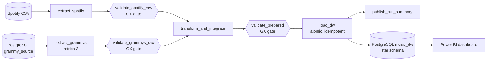

# Workshop 2 — Reliable ETL: Spotify popularity & audio profile of Grammy-recognised tracks

A batch ETL pipeline orchestrated with **Apache Airflow 3.1.8** that integrates a **relational Grammy source (PostgreSQL)** with a **Spotify CSV**,
validates both with **Great Expectations 1.23.1**, loads a **star-schema data warehouse** in PostgreSQL and serves a dashboard.

> Spanish step-by-step for your computer: **[GUIA_PASO_A_PASO.md](GUIA_PASO_A_PASO.md)**.

## Business question
Is a Grammy recognition reflected in Spotify popularity, how has the "Grammy sound" changed by decade, and which genres/families concentrate recognised tracks?
Requirements AR1–AR3: [docs/requirements_traceability.md](docs/requirements_traceability.md).

## Architecture

Airflow only orchestrates; logic lives in `src/`. Tasks exchange compact metadata (paths, counts, hashes), never DataFrames.

## Repository map
| Path | Content |
|---|---|
| `dags/reliable_music_pipeline.py` | the DAG (TaskFlow, `airflow.sdk`) |
| `src/` | `extract`, `validation`, `quality_rules` (rule registry), `transform`, `load`, `schemas`, `config`, `errors` |
| `sql/` | `source_setup.sql`, `dw_schema.sql` (tables + BI views), `00_create_databases.sh` |
| `scripts/` | source preparation, bad-batch generator, docs/notebook/preview builders |
| `notebooks/data_profiling.ipynb` | executed profiling (structure, content, relationships) |
| `gx/expectation_suites/` | exported GX Expectation Suites (JSON) |
| `docs/` | requirements, dimensional model, quality rules (36 rules / 73 expectations), transformation decisions, failure policy, dashboard guide, test scenarios, `evidence/` |
| `tests/` | 32 unit tests |
| `Dockerfile`, `docker-compose.yaml`, `.env.example` | environment (compose = official 3.1.8 file + marked changes) |

## Quick start
```bash
cp .env.example .env                                 # PowerShell: Copy-Item .env.example .env
docker compose build && docker compose up airflow-init && docker compose up -d
docker compose exec airflow-scheduler python /opt/airflow/scripts/load_grammy_source.py   # -> RECONCILED: True
# Airflow UI http://localhost:8080 (airflow/airflow) -> unpause + trigger grammy_spotify_reliable_pipeline
docker compose exec etl-db psql -U etl_user -d music_dw -c "select * from dw.v_kpi_headline;"
```
Controlled failure: `make_bad_batches.py spotify`, then *Trigger DAG w/ config* `{"spotify_filename": "spotify_dataset_bad.csv"}`. Details: [docs/test_scenarios.md](docs/test_scenarios.md).

## Key design decisions
| Topic | Decision |
|---|---|
| Quality gates | 3 gates: raw Spotify, raw Grammy (parallel branches), prepared. `critical` → STOP, `warning` → continue + record, `info` → record |
| Retries | only for transient infrastructure (`extract_grammys` 3x back-off, `load_dw` 2x); data/contract errors raise `AirflowFailException` (no retry) |
| Rerun | whole load is one transaction, full refresh, deterministic surrogate keys, `batch_key` audit |
| Integration | normalised title + artist containment; 6.33% of Grammy records matched; coverage is itself a KPI |
| Honest limits | `winner` unusable (always True; 2019 lists all nominees), small n in early decades, popularity is current not historical |

## Results of the authoring runs (see `docs/evidence/`)
Success: 4,804 facts / 304 matched; critical failure (SP-05) blocks 4 downstream tasks and leaves the DW unchanged; reruns keep 4,804 rows with `load_count` incrementing.

## Verification status
Executed by the author: pipeline code on Airflow 3.1.8 (`dag.test()`), GX 1.23.1, PostgreSQL 16 (5 runs), 32 unit tests, profiling notebook.
**Not executed** in the authoring environment: Docker build/compose, Airflow UI/Celery executor, live transient-retry, Power BI.
