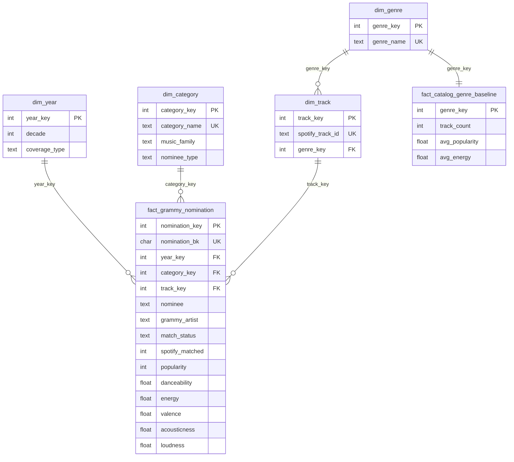

# Dimensional model (star schema / fact constellation)

Database `music_dw`, schema `dw`. DDL: `sql/dw_schema.sql`.

## Facts

| Table | Grain (one row per...) | Measures | Additivity |
|---|---|---|---|
| `fact_grammy_nomination` | **Grammy award record**: year x category x nominee x artist (4,804 rows) | `nomination_count` (=1), `popularity`, `duration_ms`, `danceability`, `energy`, `valence`, `acousticness`, `loudness`, `tempo` (NULL when unmatched) | count additive; Spotify measures are **non-additive** (always averaged) |
| `fact_catalog_genre_baseline` | **Spotify primary genre** (113 rows): reference population for AR1 | `track_count`, `avg_popularity`, `avg_*` | `track_count` additive; averages non-additive |

Degenerate dimensions in the fact: `nominee`, `grammy_artist`, `match_status`, `nomination_bk`.

## Dimensions

| Dimension | Business key | Surrogate key | Notes |
|---|---|---|---|
| `dim_year` | calendar year | `year_key` = year | `decade`, `ceremony_title`, **`coverage_type`** (`winners_only` for 1958-2018, `all_nominees` for 2019) |
| `dim_category` | harmonised `category_name` | `category_key` (sorted, 1..626) | `music_family` (18 values), `nominee_type` (recording / album / person) |
| `dim_genre` | `genre_name` | `genre_key` (sorted) | member **-1 = Unknown / not matched** |
| `dim_track` | `spotify_track_id` | `track_key` (sorted) | only tracks referenced by a nomination (222) + member **-1** |

## Key and integrity strategy
* Surrogate keys are assigned in the transform step from **sorted business keys**, so the same input always yields the same keys.
* Unmatched nominations point to the **unknown member** (`track_key = -1`) instead of NULL: joins never drop them and match coverage stays measurable.
* PK / FK / UNIQUE / CHECK constraints are enforced by PostgreSQL; the prepared gate (PR-02..PR-05) checks the same invariants *before* loading.

## Assumptions and limitations
1. **Integration is approximate**: no shared key; normalised title equality + artist containment. Only recording-level nominations are matchable (albums and people are excluded); 6.33% of records match.
2. When several Spotify tracks match one nomination, the **highest-popularity** copy is chosen (ties: smallest `track_id`). This can bias popularity upwards; 115 of 304 matches were ambiguous (monitored by PR-09).
3. A track in several Spotify genres is represented by its **primary genre** (genre of its highest-popularity copy); multi-genre membership is not modelled.
4. Spotify popularity is a *current* score, Grammy year is historical: AR1 measures *present-day* popularity of recognised tracks, not popularity at award time.
5. `winner` is unusable; 2019 contains all nominees while earlier years contain winners only (`coverage_type`). Decade comparisons for the 2010s mix both.
6. Small samples: 5 matches in the 1950s, 20 in the 1960s. Every chart shows `n`.
7. Averages are per **nomination**, so a track nominated in two categories counts twice.
